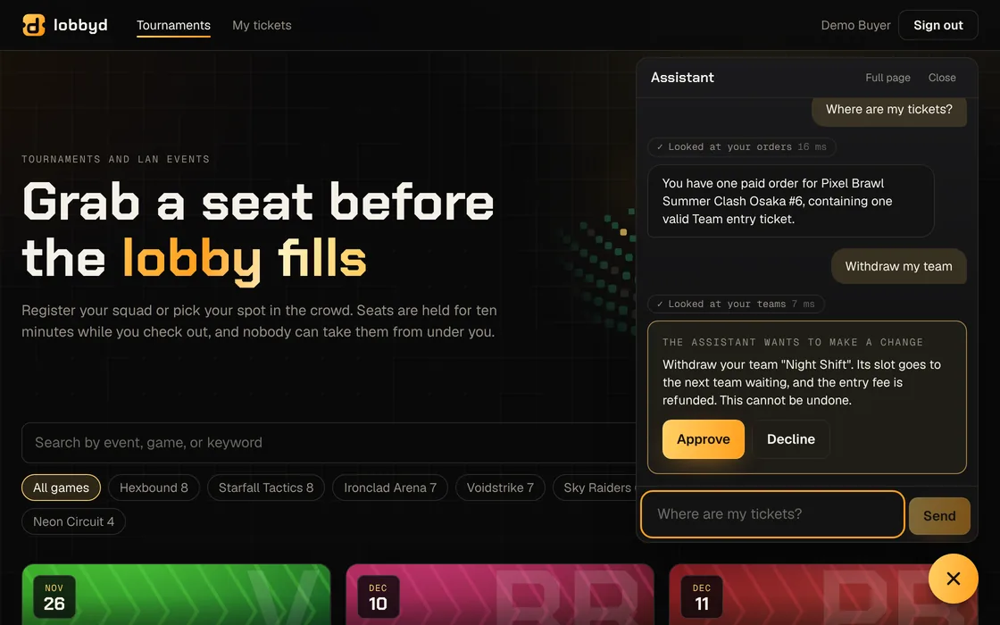

<h1> lobbyd</h1>

Ticketing and registration backend for gaming tournaments and LAN events. FastAPI, Postgres, Redis.

Teams register for a limited number of competitor slots, spectators pick seats from a venue map, everyone pays, and tickets are scanned at the door. Popular tournaments sell out in seconds, so the interesting part is staying correct and fast when thousands of people want the same seats at once.

**Live demo: [lobbyd.vercel.app](https://lobbyd.vercel.app)** · API docs: [lobbyd-api.onrender.com/docs](https://lobbyd-api.onrender.com/docs)

| Sign in as | Email | Password |
| --- | --- | --- |
| A buyer | `buyer@example.com` | `buyer-demo-password` |
| An organizer | `organizer@example.com` | `organizer-demo-password` |

The demo runs on free hosting that sleeps when idle, so the first page can take up to a minute to wake. It holds no real data and resets itself daily.

> **Status: all eight phases and the demo client are complete.** Browse, queue for a turn when a sale is oversubscribed, pick seats on a live map, enter a team or join the waitlist when slots are full, pay through a simulated provider that can be told to misbehave, and receive tickets with signed QR codes. Organizers create tournaments and watch sales from a dashboard. An AI assistant answers questions about a user's own orders and teams and can act for them, with their approval. On the day: scan tickets at the door with the camera, online or offline, and follow a bracket that updates live. Load tested, with the [results](docs/benchmarks.md) published, bad numbers included. Instrumented with metrics, traces, a dashboard, and alerts.

## Why this project exists

"Design a ticketing system" is a classic system design question because a small feature list hides hard problems: overselling, double charging, lost events, cache stampedes, traffic spikes. lobbyd is a working answer to that question, with the trade-offs written down and the claims backed by load tests.

It then asks a second question on top of the first: what does it take to let an AI agent operate a system like this safely?

## Documents

| Document | What it covers |
| --- | --- |
| [Design](docs/design.md) | Requirements, core flows, capacity targets, architecture |
| [Data model](docs/data-model.md) | Postgres schema, constraints, indexes, and the reason for each |
| [Decision records](docs/adr/README.md) | One short record per significant technical choice |
| [Roadmap](docs/roadmap.md) | Build phases and what "done" means for each |
| [Benchmarks](docs/benchmarks.md) | Load test results, what was slow at first, and what fixed it |
| [Query plans](docs/query-plans.md) | What `EXPLAIN ANALYZE` showed for each hot query, and what was fixed |
| [Errors](docs/errors.md) | Error format and every error code |
| [Assistant](docs/assistant.md) | The AI agent: what it can do, what keeps it safe, and how real models are measured |
| [Observability](docs/observability.md) | Metrics, alerts, traces, and how to watch a load test on the dashboard |
| [Scaling](docs/scaling.md) | What changes, in what order, at 100 times the load |
| [Deploy](docs/deploy.md) | Putting the demo online on free plans |

## Stack

| Area | Tools |
| --- | --- |
| Backend | Python, FastAPI, SQLAlchemy 2 (async) with asyncpg, Alembic, workers on Redis Streams |
| Data | Postgres, Redis |
| Demo client | Next.js, React, TypeScript, Tailwind CSS, TanStack Query, types generated from the API's OpenAPI document |
| Testing | pytest against a real Postgres and Redis, Locust for load tests |
| AI assistant | An agent loop over tool calling, provider behind one interface (Gemini on the free tier), scenario evals |
| Caching and limits | Redis read-through cache with stampede protection, token-bucket rate limits, a waiting room |
| Workspace | Nx monorepo, uv for Python, Docker Compose, GitHub Actions |

**Free tooling only.** Everything here is open source and runs locally with Docker Compose at no cost. The hosted demo uses free tiers only, and nothing in the project requires a paid plan or a credit card.

## The demo client

A deliberately thin Next.js app: the backend is the project. A few things in it are still worth a look.

- **Types come from the API.** `libs/api-client` is generated from the backend's OpenAPI document, and every request in the client is checked against it. Rename a field in Python and the TypeScript build fails. CI also fails if the generated types are stale.
- **No CORS, no API address in the bundle.** The browser only talks to its own origin; a route handler forwards `/api/*` to the backend, whose address is a server-side setting.
- **The seat map scales.** A 12,000 seat arena is shown as a section overview, then one section's seats at a time, with availability refreshed every few seconds. A seat someone else takes while you have it selected drops out of your basket with a message.
- **Artwork and motion are code, not assets.** Tournament covers are generated from the game's name. The hero is an arena you can play with: seats rise under the pointer, a wave runs through the stands, seats sell while you watch, and a click claims a burst of them. One animation loop writes styles directly, so nothing re-renders, and it stops when off screen. All motion is switched off for people who ask their device for reduced motion.
- **Live without reloading.** Seats other buyers take grey out within a quarter of a second, and brackets update for every viewer, over one WebSocket.
- **Retries are safe from the first click.** Each "hold" and "pay" action carries an idempotency key, so a double click or a retried request cannot hold or charge twice.

## How overselling is prevented

The short version, with the details in [ADR 0002](docs/adr/0002-claiming-inventory.md):

1. **A claim is one conditional write.** "Is it free?" and "take it" are a single SQL statement, so no other buyer can get in between.
2. **Deadlines live on the data.** A seat whose hold has lapsed is free the instant it lapses. No background job has to run for it to go back on sale.
3. **Locks are always taken in the same order,** so simultaneous buyers queue instead of deadlocking.
4. **The database refuses to oversell.** Constraints make an oversold counter or a second ticket for one seat impossible to store, whatever the application does.
5. **Retries are safe.** Every booking request carries an idempotency key; sending it twice returns the first answer and does nothing more.

The tests fire up to 400 simultaneous buyers at one sale and then check 21 statements that must hold across the tables ([`reconcile.py`](apps/api/src/lobbyd/reconcile.py)). Each safeguard was also deleted on purpose to confirm the tests fail without it.

## The assistant

Details in [the assistant](docs/assistant.md) and [ADR 0009](docs/adr/0009-assistant-agent.md).



A chat button in the corner of every page. It answers questions about your own orders, tickets, teams and waitlist place, and can make a few changes for you. The design assumes the model will sometimes be wrong or be talked into things, so safety does not depend on the prompt:

1. **It has your permissions and no more.** Its tools are calls to the public API with your own token. There is no database access and no service account.
2. **It asks before it changes anything.** A change is stored and shown to you; approving runs exactly the call that was shown.
3. **Planted instructions get nowhere.** Text hidden in a tournament description can, at worst, make it ask you a question.
4. **Made-up amounts are caught.** Money in an answer must trace back to something it looked up.
5. **It is measured.** Fourteen scenarios build real state and grade what happened with plain checks. A free Gemini model passes 14 of 14; a stand-in that only says "I don't know" passes 4. The first real run scored 12, and both failures turned out to be mistakes in the scenarios, which is written up too.

## How payments stay correct

Details in ADRs [0003](docs/adr/0003-idempotency-keys.md) and [0004](docs/adr/0004-transactional-outbox.md).

1. **Checkout never waits on the provider.** It records a pending order and an event in one transaction and returns. A worker makes the provider call, so no database transaction is ever open across a network request, and checkout works while the provider is down.
2. **Events cannot be lost.** They are written in the same transaction as the change they describe (the outbox), then relayed. Delivery is at least once, so every handler is safe to run twice.
3. **A payment only moves forward.** Each status change is allowed only from specific earlier statuses. A webhook that arrives twice, late, or out of order finds nothing to change.
4. **Webhooks are verified** by HMAC signature over a timestamp and the body, compared in constant time, with old timestamps refused.
5. **Webhooks are not trusted to arrive.** Payments that go quiet are looked up at the provider.
6. **Nobody pays for nothing.** If payment lands after the seats went to someone else, the second buyer keeps them and the first is refunded automatically.

Try the failure modes yourself with the `payment_method` field of `POST /orders`:

| Method | What the simulated provider does |
| --- | --- |
| `pm_success` | Pays after about 1.5 seconds |
| `pm_declined` | Refuses. The order is cancelled and the inventory goes straight back on sale |
| `pm_duplicate` | Pays, and sends the confirmation twice |
| `pm_reordered` | Pays, and sends "succeeded" before "processing" |
| `pm_slow` | Pays after 20 seconds |
| `pm_never` | Pays, and never tells us. Found by polling after a minute |

## The reusable part: onceonly

The two mechanisms under every purchase are not specific to tickets, so they live in their own package, [`libs/onceonly`](libs/onceonly): idempotency keys and a transactional outbox for async SQLAlchemy and Postgres, with a Redis Streams consumer that retries and dead-letters. lobbyd depends on it like any other library and adds only what is its own: the HTTP header, the error format, trace context and metrics.

It has its own tests against a real Postgres and Redis, including the races (twelve retries of one key at once, two relays competing for the same events), and builds as a wheel with `npx nx run onceonly:package`.

## Running it

**Everything in Docker** (needs only Docker):

```bash
docker compose up --build
```

Then open **http://localhost:3000** for the demo client. The API is at http://localhost:8000, with interactive docs at http://localhost:8000/docs.

To fill it with demo data (three venues including a 12,000 seat arena, 60 bookable tournaments, and organizer and buyer logins that it prints):

```bash
docker compose run --rm api lobbyd-seed
```

In the client, choose **Sign in**, then **Use the demo buyer**. Pick a tournament, choose seats, hold them, and at checkout try the different payment options to watch the system handle a declined card, a duplicated confirmation, or a provider that goes quiet.

**For development** (needs Node 22 and [uv](https://docs.astral.sh/uv/)):

```bash
npm install                             # Nx
uv sync                                 # Python dependencies for the whole workspace
docker compose up -d postgres redis     # just the data stores
npx nx migrate api                      # apply database migrations
npx nx serve api                        # API with reload on http://localhost:8000
npx nx serve paysim                     # payment simulator on http://localhost:8001
cd apps/api && uv run lobbyd-worker     # background work (payments, emails, housekeeping)
npx nx serve web                        # demo client on http://localhost:3000
```

| Command | What it does |
| --- | --- |
| `npx nx test api` | Tests, against the real Postgres and Redis from Compose |
| `npx nx lint api` | Ruff lint and format check (`npx nx format api` to fix) |
| `npx nx typecheck api` | mypy in strict mode |
| `npx nx boundaries api` | Checks module boundaries with import-linter |
| `uv run lobbyd-seed` | Demo data. `--tournaments 50000` for a dataset big enough to study query plans; `--reset` wipes first |
| `uv run lobbyd-admin set-role <email> organizer` | Change an account's role |
| `cd apps/api && uv run python bench/run.py steady` | A load test against real processes (see [benchmarks](docs/benchmarks.md) for the scenarios) |
| `npx nx generate api-client` | Regenerate the web client's TypeScript types from the API |
| `npm run check` | All of the above for every project |

Nx is only the task runner. Each target is a plain `uv run ...` command, so `cd apps/api && uv run pytest` works without Node.

## Layout

```
apps/api/            FastAPI application
  src/lobbyd/
    platform/        shared plumbing: database, cache, errors, logging, ids
    identity/        accounts, login, tokens, roles
    catalog/         venues, seat maps, tournaments, ticket types, search
    inventory/       availability, holds, the claim logic
    orders/          checkout
    tickets/         issued tickets
    payments/        payment records, provider client, webhook signatures
    waitingroom/     the queue in front of oversubscribed sales
    notifications/   emails to buyers (recorded, not sent)
    worker.py        outbox relay, event handlers, housekeeping
    reconcile.py     cross-table consistency checks
  migrations/        Alembic migrations (the schema's source of truth)
  bench/             load-test scenarios and their results
  tests/
apps/paysim/         payment provider simulator (separate service)
apps/web/            demo client (Next.js)
libs/api-client/     TypeScript types generated from the API's OpenAPI document
libs/onceonly/       idempotency keys and a transactional outbox, as a standalone package
docs/                design, data model, decision records, roadmap
ops/                 local infrastructure config
```

## License

MIT
