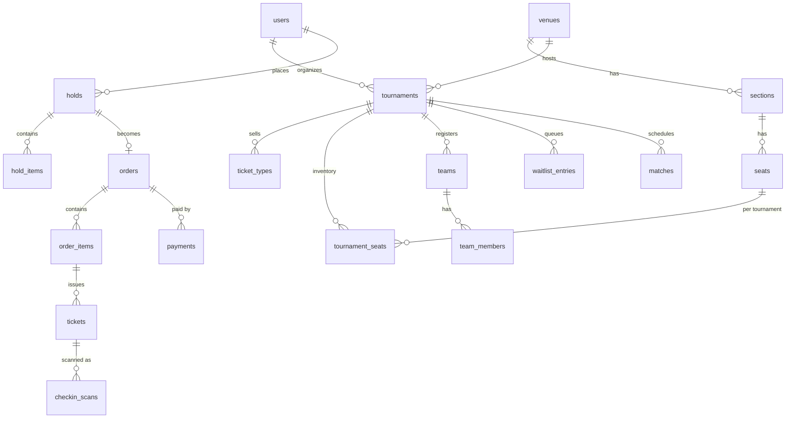

# Data model

Postgres is the source of truth. The schema below is the starting design; Alembic migrations will be the authoritative version once code exists.

## Conventions

- **Keys:** UUIDv7 primary keys. They are time-ordered, so inserts stay local in the index like a sequence would, and they can be generated by the application before the insert (useful for idempotency and for the outbox).
- **Money:** integer minor units (`price_cents`) plus a currency code. Never floating point.
- **Time:** `timestamptz` everywhere, stored in UTC. Venue timezone is kept separately for display.
- **Status columns:** `text` with a `CHECK` constraint rather than Postgres enums, because adding a value to a check is an ordinary migration.
- **Deletes:** rows that money or tickets depend on are never deleted; they change status.

## Overview



## Catalog

Implemented in phase 2. The migrations in `apps/api/migrations` are authoritative; this is the same schema with the reasoning attached.

```sql
CREATE TABLE users (
    id            uuid PRIMARY KEY,
    email         citext NOT NULL UNIQUE,
    display_name  text NOT NULL,
    password_hash text NOT NULL,
    role          text NOT NULL DEFAULT 'user'
                  CHECK (role IN ('user', 'organizer', 'staff', 'admin')),
    created_at    timestamptz NOT NULL DEFAULT now()
);

CREATE TABLE venues (
    id         uuid PRIMARY KEY,
    owner_id   uuid NOT NULL REFERENCES users,   -- only the owner can run events here
    name       text NOT NULL,
    city       text NOT NULL,
    timezone   text NOT NULL,                    -- IANA name, for display only
    created_at timestamptz NOT NULL DEFAULT now()
);

CREATE TABLE sections (
    id         uuid PRIMARY KEY,
    venue_id   uuid NOT NULL REFERENCES venues ON DELETE CASCADE,
    name       text NOT NULL,
    sort       int  NOT NULL,
    seat_count int  NOT NULL,                    -- kept here so listing never counts seats
    UNIQUE (venue_id, name)
);

CREATE TABLE seats (
    id         uuid PRIMARY KEY,
    venue_id   uuid NOT NULL REFERENCES venues ON DELETE CASCADE,
    section_id uuid NOT NULL REFERENCES sections ON DELETE CASCADE,
    row_label  text NOT NULL,
    row_sort   int  NOT NULL,                    -- rows keep the order they were entered in
    number     int  NOT NULL,
    UNIQUE (section_id, row_label, number)
);
CREATE INDEX seats_venue_id_idx ON seats (venue_id);

CREATE TABLE tournaments (
    id            uuid PRIMARY KEY,
    organizer_id  uuid NOT NULL REFERENCES users,
    venue_id      uuid REFERENCES venues,        -- null for online-only events
    slug          text NOT NULL UNIQUE,
    title         text NOT NULL,
    game          citext NOT NULL,               -- filter by game ignores case
    description   text NOT NULL DEFAULT '',
    team_size     int  NOT NULL CHECK (team_size >= 1),
    currency      char(3) NOT NULL,              -- one per tournament: an order never mixes currencies
    starts_at     timestamptz NOT NULL,
    ends_at       timestamptz NOT NULL,
    sales_open_at timestamptz NOT NULL,
    status        text NOT NULL DEFAULT 'draft'
                  CHECK (status IN ('draft', 'published', 'live', 'completed', 'cancelled')),
    search        tsvector GENERATED ALWAYS AS (
                      setweight(to_tsvector('english', title), 'A') ||
                      setweight(to_tsvector('english', game::text), 'A') ||
                      setweight(to_tsvector('english', description), 'C')
                  ) STORED,
    created_at    timestamptz NOT NULL DEFAULT now(),
    CHECK (ends_at > starts_at),
    CHECK (ends_at <= starts_at + interval '14 days'),
    CHECK (sales_open_at < starts_at)
);

CREATE INDEX tournaments_search_idx ON tournaments USING gin (search);
-- Browse: listed events in date order, with (starts_at, id) as the pagination cursor.
CREATE INDEX tournaments_browse_idx ON tournaments (starts_at, id)
    WHERE status IN ('published', 'live');
-- The same, for one game.
CREATE INDEX tournaments_game_browse_idx ON tournaments (game, starts_at, id)
    WHERE status IN ('published', 'live');
CREATE INDEX tournaments_organizer_id_idx ON tournaments (organizer_id, created_at);

CREATE TABLE ticket_types (
    id            uuid PRIMARY KEY,
    tournament_id uuid NOT NULL REFERENCES tournaments ON DELETE CASCADE,
    kind          text NOT NULL CHECK (kind IN ('competitor', 'reserved', 'general')),
    name          text NOT NULL,
    price_cents   int  NOT NULL CHECK (price_cents >= 0),
    capacity      int  NOT NULL CHECK (capacity >= 1),  -- for 'reserved': seats in its sections
    created_at    timestamptz NOT NULL DEFAULT now(),
    UNIQUE (tournament_id, name),
    UNIQUE (id, tournament_id)                   -- target for the composite key below
);
-- A tournament has one set of team slots.
CREATE UNIQUE INDEX ticket_types_one_competitor_idx ON ticket_types (tournament_id)
    WHERE kind = 'competitor';

-- Which venue sections a reserved-seating ticket type sells.
CREATE TABLE ticket_type_sections (
    ticket_type_id uuid NOT NULL,
    section_id     uuid NOT NULL REFERENCES sections,
    tournament_id  uuid NOT NULL,
    PRIMARY KEY (ticket_type_id, section_id),
    FOREIGN KEY (ticket_type_id, tournament_id)
        REFERENCES ticket_types (id, tournament_id) ON DELETE CASCADE,
    UNIQUE (tournament_id, section_id)           -- a section has one price per tournament
);
```

**Notes**

- `seats` describes the physical venue and is reused across tournaments. What is for sale at a given tournament lives in the inventory tables below.
- The 14 day limit on length is a business rule that exists for a query: it lets "not ended yet" be answered from the `starts_at` index. See [query plans](query-plans.md).
- `ticket_type_sections` copies `tournament_id` so the database can enforce "one ticket type per section per tournament" with a plain unique constraint. The composite foreign key guarantees the copy can never disagree with the ticket type.
- Rules that span rows are constraints, not application checks, so they hold when two requests race: one competitor type per tournament, unique names, one price per section. The API maps each constraint to its own error code.

## Inventory

Implemented in phase 3. There are two inventory shapes, created when a tournament is published.

```sql
-- Counted inventory, for 'competitor' and 'general' ticket types.
CREATE TABLE inventory_counters (
    ticket_type_id uuid PRIMARY KEY REFERENCES ticket_types ON DELETE CASCADE,
    tournament_id  uuid NOT NULL REFERENCES tournaments ON DELETE CASCADE,
    capacity       int NOT NULL CHECK (capacity >= 0),
    held_count     int NOT NULL DEFAULT 0 CHECK (held_count >= 0),
    sold_count     int NOT NULL DEFAULT 0 CHECK (sold_count >= 0),
    CONSTRAINT no_oversell CHECK (held_count + sold_count <= capacity)
);

-- Reserved seating: one row per seat per tournament.
CREATE TABLE tournament_seats (
    tournament_id  uuid NOT NULL REFERENCES tournaments ON DELETE CASCADE,
    seat_id        uuid NOT NULL REFERENCES seats,
    ticket_type_id uuid NOT NULL REFERENCES ticket_types,
    status         text NOT NULL DEFAULT 'available'
                   CHECK (status IN ('available', 'held', 'sold', 'blocked')),
    hold_id        uuid,
    held_until     timestamptz,
    PRIMARY KEY (tournament_id, seat_id),
    -- Only a held seat has a holder and a deadline, and it always has both.
    CONSTRAINT held_has_owner CHECK (
        (status = 'held') = (hold_id IS NOT NULL)
        AND (hold_id IS NULL) = (held_until IS NULL)
    )
);
CREATE INDEX tournament_seats_hold_id_idx ON tournament_seats (hold_id) WHERE hold_id IS NOT NULL;
-- Lets the sweeper find lapsed seats without scanning every seat.
CREATE INDEX tournament_seats_held_until_idx ON tournament_seats (held_until) WHERE status = 'held';
```

**Why these constraints exist**

- `no_oversell` is the database's own guarantee for counted inventory. Whatever the application does, a transaction that would push held plus sold past capacity fails. Application logic is the first line of defence; this is the one that cannot be bypassed.
- The counters live in their own table, not on `ticket_types`, because each module owns its tables: the catalog describes what is on sale, the inventory module tracks what is left.
- The primary key `(tournament_id, seat_id)` means a seat exists once per tournament, so "claim this seat" is an update to exactly one row, and the row lock is what serialises competing buyers.
- `held_until` lives on the seat row itself so a claim can treat a lapsed hold as available in the same statement, without waiting for a cleanup job. See [ADR 0002](adr/0002-claiming-inventory.md).

A seat's `status` alone does not say whether it is free: a row can read `held` after its deadline has passed. A seat is free when it is `available`, or `held` with `held_until` in the past.

## Holds

```sql
CREATE TABLE holds (
    id            uuid PRIMARY KEY,
    user_id       uuid NOT NULL REFERENCES users,
    tournament_id uuid NOT NULL REFERENCES tournaments,
    currency      char(3) NOT NULL,
    status        text NOT NULL DEFAULT 'active'
                  CHECK (status IN ('active', 'converted', 'expired', 'released')),
    expires_at    timestamptz NOT NULL,
    created_at    timestamptz NOT NULL DEFAULT now()
);

-- The sweeper's only query.
CREATE INDEX holds_expiry_idx ON holds (expires_at) WHERE status = 'active';
-- One open hold per user per tournament.
CREATE UNIQUE INDEX holds_one_active_idx ON holds (user_id, tournament_id) WHERE status = 'active';

CREATE TABLE hold_items (
    id               uuid PRIMARY KEY,
    hold_id          uuid NOT NULL REFERENCES holds ON DELETE CASCADE,
    ticket_type_id   uuid NOT NULL REFERENCES ticket_types,
    seat_id          uuid REFERENCES seats,        -- set for reserved seating
    quantity         int  NOT NULL DEFAULT 1 CHECK (quantity >= 1),
    unit_price_cents int  NOT NULL,                -- price when held is the price charged
    CHECK (seat_id IS NULL OR quantity = 1)
);
CREATE INDEX hold_items_hold_id_idx ON hold_items (hold_id);
```

`holds_one_active_idx` stops one account from hoarding inventory across many holds, and it settles the race when one user sends two hold requests at once: the second insert fails on the index. Because expiry is lazy, a user's old hold can still say `active` after its time has passed; creating a new hold first closes the user's own lapsed hold in the same transaction, so the index never locks anyone out.

## Orders and tickets

Implemented in phase 3 with payment stubbed (an order is created already paid). The `payments` and `payment_events` tables arrive with real payments in phase 4.

```sql
CREATE TABLE orders (
    id            uuid PRIMARY KEY,
    user_id       uuid NOT NULL REFERENCES users,
    tournament_id uuid NOT NULL REFERENCES tournaments,
    hold_id       uuid NOT NULL UNIQUE REFERENCES holds,   -- one order per hold
    status        text NOT NULL DEFAULT 'pending'
                  CHECK (status IN ('pending', 'paid', 'expired', 'cancelled', 'refunded')),
    total_cents   int  NOT NULL CHECK (total_cents >= 0),
    currency      char(3) NOT NULL,                        -- copied from the tournament
    created_at    timestamptz NOT NULL DEFAULT now(),
    paid_at       timestamptz
);
CREATE INDEX orders_user_id_idx ON orders (user_id, created_at);

CREATE TABLE order_items (
    id               uuid PRIMARY KEY,
    order_id         uuid NOT NULL REFERENCES orders ON DELETE CASCADE,
    ticket_type_id   uuid NOT NULL REFERENCES ticket_types,
    seat_id          uuid REFERENCES seats,
    quantity         int  NOT NULL CHECK (quantity >= 1),
    unit_price_cents int  NOT NULL                 -- price at time of purchase
);
CREATE INDEX order_items_order_id_idx ON order_items (order_id);

CREATE TABLE tickets (
    id             uuid PRIMARY KEY,
    order_id       uuid NOT NULL,
    order_item_id  uuid NOT NULL,
    tournament_id  uuid NOT NULL REFERENCES tournaments,
    ticket_type_id uuid NOT NULL REFERENCES ticket_types,
    seat_id        uuid REFERENCES seats,
    holder_id      uuid NOT NULL REFERENCES users,
    status         text NOT NULL DEFAULT 'valid' CHECK (status IN ('valid', 'void')),
    checked_in_at  timestamptz,
    issued_at      timestamptz NOT NULL DEFAULT now()
);
-- Second line of defence: two valid tickets for one seat cannot exist.
CREATE UNIQUE INDEX tickets_one_per_seat_idx
    ON tickets (tournament_id, seat_id) WHERE status = 'valid' AND seat_id IS NOT NULL;
CREATE INDEX tickets_order_id_idx ON tickets (order_id);
CREATE INDEX tickets_holder_id_idx ON tickets (holder_id);
```

- `orders.hold_id` is unique, so even a double submit that slipped past everything else cannot create a second order for one hold.
- `unit_price_cents` is copied onto the order item so that changing a ticket type's price later never rewrites history.
- Checkout moves inventory from held to sold, records the order, and issues the tickets in one transaction.

Planned for phase 4:

```sql
CREATE TABLE payments (
    id           uuid PRIMARY KEY,
    order_id     uuid NOT NULL REFERENCES orders,
    provider_ref text NOT NULL UNIQUE,             -- the provider's payment id
    status       text NOT NULL
                 CHECK (status IN ('created', 'succeeded', 'failed', 'refunded')),
    amount_cents int  NOT NULL,
    currency     char(3) NOT NULL,
    created_at   timestamptz NOT NULL DEFAULT now()
);

-- Every webhook delivery we have accepted. The unique id is the deduplication.
CREATE TABLE payment_events (
    provider_event_id text PRIMARY KEY,
    payment_id        uuid REFERENCES payments,
    type              text NOT NULL,
    payload           jsonb NOT NULL,
    received_at       timestamptz NOT NULL DEFAULT now()
);
```

## Teams and waitlist

```sql
CREATE TABLE teams (
    id            uuid PRIMARY KEY,
    tournament_id uuid NOT NULL REFERENCES tournaments,
    captain_id    uuid NOT NULL REFERENCES users,
    name          text NOT NULL,
    status        text NOT NULL DEFAULT 'pending'
                  CHECK (status IN ('pending', 'confirmed', 'withdrawn')),
    created_at    timestamptz NOT NULL DEFAULT now(),
    UNIQUE (id, tournament_id)                     -- target for the composite key below
);
CREATE UNIQUE INDEX teams_name_idx ON teams (tournament_id, lower(name)) WHERE status <> 'withdrawn';

CREATE TABLE team_members (
    team_id       uuid NOT NULL,
    tournament_id uuid NOT NULL,                   -- denormalised for the unique index below
    handle        text NOT NULL,                   -- in-game name
    user_id       uuid REFERENCES users,           -- optional link to an account
    PRIMARY KEY (team_id, handle),
    -- Guarantees the copied tournament_id always matches the team's.
    FOREIGN KEY (team_id, tournament_id) REFERENCES teams (id, tournament_id) ON DELETE CASCADE
);
-- A player competes for one team per tournament.
CREATE UNIQUE INDEX team_members_one_team_idx ON team_members (tournament_id, lower(handle));
-- When a team withdraws its member rows are removed, which frees those players to join another team.

CREATE TABLE waitlist_entries (
    id            uuid PRIMARY KEY,
    tournament_id uuid NOT NULL REFERENCES tournaments,
    captain_id    uuid NOT NULL REFERENCES users,
    roster        jsonb NOT NULL,                  -- proposed team, validated on promotion
    status        text NOT NULL DEFAULT 'waiting'
                  CHECK (status IN ('waiting', 'offered', 'accepted', 'lapsed', 'left')),
    offered_hold_id uuid REFERENCES holds,
    created_at    timestamptz NOT NULL DEFAULT now(),
    UNIQUE (tournament_id, captain_id)
);
-- "Who is next?" in arrival order.
CREATE INDEX waitlist_next_idx ON waitlist_entries (tournament_id, created_at) WHERE status = 'waiting';
```

## Check-in

Planned for phase 7. The `tickets` table is above.

```sql
CREATE TABLE checkin_scans (
    id         uuid PRIMARY KEY,                   -- generated by the scanner, so re-uploads deduplicate
    ticket_id  uuid NOT NULL REFERENCES tickets,
    device_id  text NOT NULL,
    scanned_at timestamptz NOT NULL,               -- device clock
    synced_at  timestamptz NOT NULL DEFAULT now(),
    result     text NOT NULL CHECK (result IN ('admitted', 'duplicate', 'void'))
);
CREATE INDEX checkin_scans_ticket_idx ON checkin_scans (ticket_id);
```

## Brackets

```sql
CREATE TABLE matches (
    id            uuid PRIMARY KEY,
    tournament_id uuid NOT NULL REFERENCES tournaments,
    round         int  NOT NULL,
    position      int  NOT NULL,                   -- slot within the round
    team_a_id     uuid REFERENCES teams,
    team_b_id     uuid REFERENCES teams,
    score_a       int,
    score_b       int,
    winner_id     uuid REFERENCES teams,
    next_match_id uuid REFERENCES matches,
    status        text NOT NULL DEFAULT 'scheduled'
                  CHECK (status IN ('scheduled', 'live', 'completed')),
    version       int  NOT NULL DEFAULT 0,         -- optimistic lock for result edits
    UNIQUE (tournament_id, round, position)
);
```

Match results are edited rarely and by few people, so a version column (reject the write if someone else changed it first) is enough here. Contrast with seats, where contention is the normal case.

## Platform tables

```sql
CREATE TABLE idempotency_keys (                    -- implemented in phase 3
    user_id       uuid NOT NULL,
    key           text NOT NULL,
    request_hash  bytea NOT NULL,                  -- same key, different request is an error
    response_code int,
    response_body text,                            -- exact text first sent, replayed as is
    created_at    timestamptz NOT NULL DEFAULT now(),
    PRIMARY KEY (user_id, key)
);
CREATE INDEX idempotency_keys_created_at_idx ON idempotency_keys (created_at);  -- for pruning

CREATE TABLE outbox (
    id           uuid PRIMARY KEY,                 -- UUIDv7, so id order is creation order
    topic        text NOT NULL,
    payload      jsonb NOT NULL,
    created_at   timestamptz NOT NULL DEFAULT now(),
    published_at timestamptz
);
-- The relay's only query: oldest unpublished first.
CREATE INDEX outbox_pending_idx ON outbox (id) WHERE published_at IS NULL;
```

Both tables grow without bound and are pruned by a scheduled job (idempotency keys after 24 hours, published outbox rows after 7 days).

## Invariants

These must be true whenever no request is in flight. The concurrency tests check every one of them after every run (`apps/api/tests/invariants.py`), with one query per rule that returns the rows breaking it.

1. No counter has held plus sold above its capacity. *(constraint)*
2. Each counter's `held_count` equals what its active holds add up to, and its `sold_count` equals its number of valid tickets.
3. No seat has more than one valid ticket. *(constraint)*
4. Every sold seat has a valid ticket, and every valid seated ticket is for a sold seat.
5. No held seat belongs to a hold that was checked out or released.
6. Every active hold that is still in time owns all of its seats.
7. Every paid order has as many valid tickets as it bought, and its total equals its items.
8. Every checked-out hold has exactly one order, and no order exists for any other hold. *(one order per hold is a constraint)*
9. No user has two active holds for one tournament. *(constraint)*
10. No payment `provider_ref` or webhook event id is recorded twice. *(constraint, phase 4)*
11. No handle appears on two teams in one tournament. *(constraint, phase 6)*

Rules marked as constraints cannot be broken by any code path. The others span tables, so they are upheld by doing the work in one transaction and verified by the tests; phase 4 adds a reconciliation job that runs the same queries in production.
