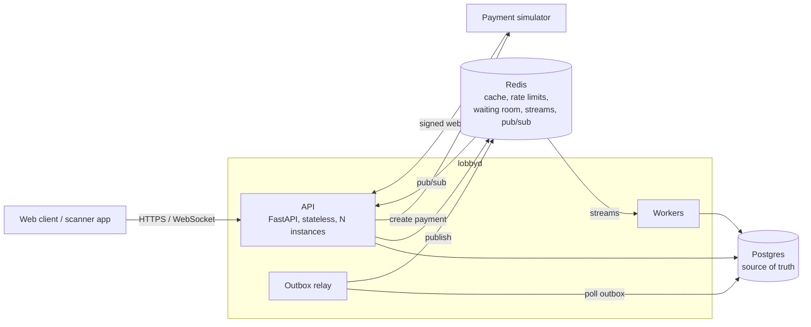
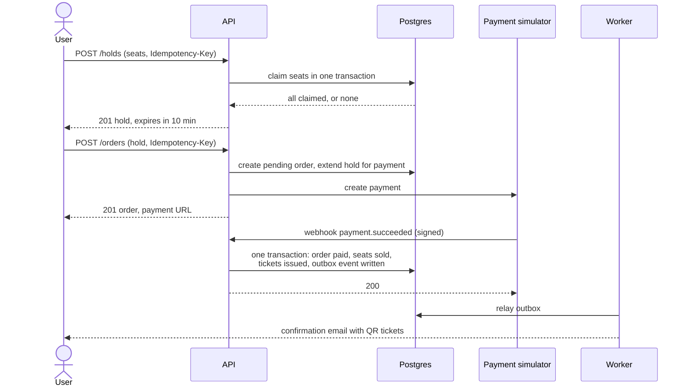
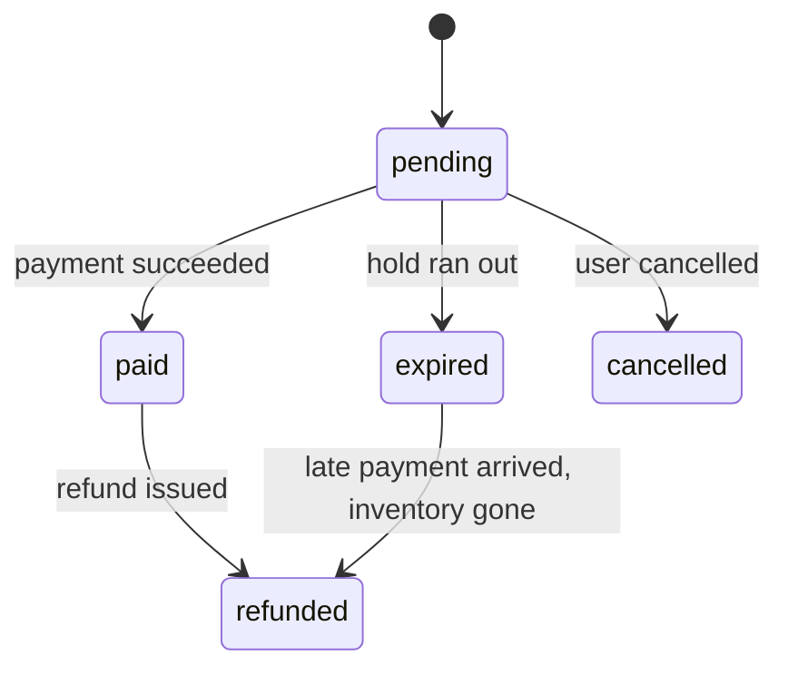

# lobbyd design

This document is written the way a system design interview answer is structured: requirements first, then numbers, then the architecture, then the hard parts.

## 1. What it does

An organizer publishes a tournament: a game, a date, a venue, a limited number of team slots, and spectator seating. Players and spectators then compete for that inventory.

There are two kinds of inventory, and they behave differently:

| Inventory | Example | Shape of the problem |
| --- | --- | --- |
| **Competitor slots** | 64 teams of 5 | Small count, very high contention, a whole roster registers or nobody does, waitlist when full |
| **Spectator tickets** | 12,000 seats in an arena, or 500 general admission | Reserved seats are individually addressable rows; general admission is a counter |

## 2. Requirements

### Functional

1. Organizers create venues with seat maps, tournaments, and ticket types with prices and capacities.
2. Anyone can browse and search published tournaments.
3. A user can **hold** inventory (a team slot, specific seats, or a quantity of general admission) for 10 minutes while they pay.
4. A user pays for a hold, which turns it into an order and issues tickets.
5. Holds that are not paid for expire and the inventory returns to sale.
6. A captain registers a team with a full roster. When slots are full, the team can join a waitlist and is offered a slot if one frees up.
7. Tickets carry a QR code. Door staff scan it; each ticket admits once. Scanning keeps working if the venue network drops.
8. Organizers record match results. Brackets update live for everyone watching.

### Non-functional

| Property | Target | Notes |
| --- | --- | --- |
| **No overselling** | Zero, always | A hard invariant, enforced by the database, not by application code alone |
| **No double charging** | Zero, always | Retried requests and duplicate webhooks must be harmless |
| **No lost confirmations** | Every paid order eventually produces its tickets and its email | At-least-once delivery with idempotent consumers |
| Browse latency | p95 under 100 ms | Read heavy, cacheable |
| Hold latency | p95 under 250 ms during a sale spike | The contended write path |
| Availability | Browsing stays up even if payments or workers are degraded | Failure isolation between read and write paths |

The first three are correctness properties and are never traded away. The latency figures were design targets; the measured results, including where they are missed under overload, are in [benchmarks](benchmarks.md).

### Out of scope

Real payment processing (a simulated provider stands in, see section 6), resale and transfers, dynamic pricing, seat map editing UI, multi-region deployment. The scaling section discusses the last one on paper.

## 3. Capacity planning

The system is sized around its worst minute, not its average day.

**Reference scenario: a flagship final goes on sale.**

- 12,000 reserved seats and 64 team slots
- 100,000 users arrive within the first 60 seconds
- Each user loads the tournament page, loads availability a few times, and attempts 1 to 3 holds

| Quantity | Estimate |
| --- | --- |
| Peak read requests | 100,000 users x ~6 reads in 60 s = ~10,000 requests/s |
| Peak hold attempts | 100,000 users x ~2 attempts in 60 s = ~3,300 requests/s |
| Successful holds | At most ~6,000 (12,000 seats at ~2 per hold); over 95% of attempts must fail fast and cheaply |
| Orders per sale | ~6,000 rows; storage is not the problem, contention is |

Three things follow from these numbers:

1. **Reads outnumber writes and almost all of them are identical.** The tournament page and seat map layout are cached; only availability changes quickly.
2. **Most hold attempts lose.** The losing path has to be as cheap as the winning path, so it cannot wait on locks.
3. **A single Postgres primary can do the write work** (a few thousand short transactions per second is within reach), but only if the spike is shaped. That is the job of the waiting room and rate limits.

A laptop running Docker Compose will not reach these numbers. The benchmarks run a scaled-down version of the same scenario and report what was measured on what hardware.

## 4. Architecture

lobbyd is a **modular monolith**: one codebase, one API process type, one worker process type, with strict module boundaries inside. See [ADR 0001](adr/0001-modular-monolith.md).

**Responsibilities**

- **Postgres** is the only source of truth. Inventory, holds, orders, payments, and tickets live here, protected by constraints.
- **Redis** holds nothing that cannot be rebuilt: cached reads, rate limit counters, the waiting room queue, the event stream between the outbox and workers, and pub/sub for WebSocket fan-out. If Redis is lost, the system slows down and loses queue positions, but no sale is corrupted.
- **API instances** are stateless, so they scale horizontally behind a load balancer.
- **Workers** do everything that does not need to happen inside the request: expiring holds, sending email, generating ticket PDFs, promoting waitlisted teams.

**Modules** (each owns its tables; other modules go through its service interface, not its tables):

`identity` · `catalog` (venues, tournaments, ticket types, search) · `inventory` (holds and availability) · `orders` · `payments` · `teams` (registration, waitlist) · `tickets` (issuing, check-in) · `brackets` · `platform` (idempotency, outbox, rate limiting, caching)

## 5. Core flows

### 5.1 Hold, pay, ticket

Order states:

The last transition matters. A payment can succeed after its hold has expired and the seats have been sold to someone else. The system never honours the order at the expense of the second buyer: it refunds automatically. Extending the hold when payment starts makes this rare, but it cannot make it impossible, so it is handled.

### 5.2 Team registration

A captain submits a team name and roster. In one transaction: a competitor slot is claimed, the team and its members are created, and uniqueness is checked (a player cannot be on two teams in the same tournament). If any part fails, nothing is kept. The team is pending until its entry fee is paid through the normal checkout, and steps aside if the hold lapses or the payment fails.

If slots are full, the team may join the waitlist. When a slot frees up (a hold expires, a team withdraws), a worker offers it to the first waitlisted team as a hold with its own, longer expiry. If that captain does not pay in time, or their roster no longer works, the offer moves to the next in line. Team entry closes when the tournament starts; spectator sales run until it ends.

### 5.3 Check-in

A ticket's QR code is a signed token, so a scanner can verify it is genuine without a network call. Admission is a single conditional update: mark the ticket checked in only if it is not already. Two scanners racing on the same ticket cannot both succeed.

If the venue network drops, scanners keep working from a manifest they downloaded earlier and upload their scans when the network returns. The limitation is stated plainly: two offline scanners cannot see each other's scans, so the same ticket could be admitted at two doors during an outage. On sync the server keeps the earliest scan, flags the rest as duplicates, and reports them. See [ADR 0006](adr/0006-check-in-tokens-and-offline-scanning.md).

### 5.4 Live brackets

Match results are written to Postgres, then published on Redis pub/sub. Every API instance subscribes and pushes the update to its own WebSocket clients, so viewers connected to different instances all see the same bracket. A client that reconnects fetches the current bracket over HTTP first, then resumes the stream, so a missed message cannot leave it permanently stale.

## 6. The hard parts

Each of these has its own decision record. This section is the summary.

| Problem | Approach | Record |
| --- | --- | --- |
| Two users claim the same seat | Seats are rows; a claim is a single conditional write inside a transaction, taken in a fixed order. Expiry is checked at claim time, so correctness never depends on a cleanup job running on time. Database constraints are a second line of defence. Three strategies will be benchmarked against each other | [0002](adr/0002-claiming-inventory.md) |
| Retries cause duplicate holds or charges | Clients send an `Idempotency-Key`; the key and the response are stored in the same transaction as the effect | [0003](adr/0003-idempotency-keys.md) |
| Order is paid but the email or ticket job is lost | Transactional outbox: the event is written in the same transaction as the state change and relayed afterwards. Consumers deduplicate | [0004](adr/0004-transactional-outbox.md) |
| 100,000 people arrive at once | Virtual waiting room in front of the hold endpoint admits users at a rate the database can serve; per-user rate limits behind it | [0005](adr/0005-waiting-room-and-rate-limits.md) |
| Everyone reloads the seat map | Layout cached for a long time, availability cached for about a second, with protection against many requests rebuilding the same entry at once | [0008](adr/0008-caching.md) |
| Payment webhooks arrive twice, late, or out of order | Verify signature, record the provider's event id under a unique constraint, apply state transitions that are safe to repeat | [0003](adr/0003-idempotency-keys.md) |

### Why a simulated payment provider

Real providers cannot be load tested for free and their sandbox webhooks are slow. The simulator is a small separate service in this repository that behaves like the real thing in the ways that matter: it responds asynchronously through signed webhooks, and it can be told to delay them, send them twice, send them out of order, or fail. That makes the failure cases testable on demand.

## 7. API sketch

All write endpoints that create something accept `Idempotency-Key`. Lists use cursor pagination. Errors follow RFC 9457 problem details.

| Method and path | Purpose |
| --- | --- |
| `GET /tournaments?q=&game=&from=&cursor=` | Search and browse |
| `GET /tournaments/{slug}` | Detail, ticket types |
| `GET /tournaments/{slug}/seats` | Seat map layout (long cache) |
| `GET /tournaments/{slug}/availability` | Seat and slot availability (short cache) |
| `GET /users/me/orders` | Order history |
| `POST /tournaments/{slug}/queue` | Join the waiting room, receive a position, later an admission token |
| `POST /holds` | Claim seats or standing tickets |
| `DELETE /holds/{id}` | Release early |
| `POST /orders` | Turn a hold into a pending order and start payment |
| `GET /orders/{id}` | Order status and tickets |
| `POST /webhooks/payments` | Payment provider callbacks |
| `POST /tournaments/{slug}/teams` | Register a team: claims a slot (and any seats in the same basket) and returns the hold to check out |
| `GET /tournaments/{slug}/teams` | Confirmed teams and rosters |
| `DELETE /teams/{id}` | Captain withdraws; the slot goes to the waitlist |
| `POST /tournaments/{slug}/waitlist` | Join the waitlist when slots are full |
| `GET /tournaments/{slug}/waitlist/me` | Place in line, or the offered hold |
| `GET /tournaments/{slug}/bracket` | Current bracket |
| `WS /tournaments/{slug}/live` | Bracket and availability updates |
| `POST /matches/{id}/result` | Organizer records a result |
| `GET /checkin/{tournament}/manifest` | Scanner downloads ticket manifest and verification key |
| `POST /checkin/scans` | Scanner submits one or many scans |

## 8. Scaling beyond one machine

Not built, but the design leaves room for it. These are the steps in the order they would be needed:

1. **More API instances.** Already possible; the API holds no state.
2. **Read replicas** for browse and search. Availability can tolerate a second of staleness because the claim itself is always checked on the primary.
3. **Partition the hot tables by tournament.** Every contended query already filters by `tournament_id`, so `tournament_seats`, `holds`, and `tickets` partition cleanly, and a finished tournament's partitions can be archived.
4. **Shard by tournament** across databases if one primary is no longer enough. A booking never spans two tournaments, so no cross-shard transactions are needed. User-level views ("my orders") become fan-out reads or a separate read model fed by the outbox.
5. **Dedicated search** (OpenSearch or similar) fed by the outbox, when Postgres full-text search stops being enough.

## 9. Observability and testing

- **Logs:** structured JSON with a request id that follows the request into workers.
- **Metrics:** Prometheus. The ones that matter: hold attempts by outcome, hold latency, oversell count (must stay at zero and is alerted on), outbox lag, waiting room depth, webhook duplicates.
- **Tracing:** OpenTelemetry across API, database, Redis, and workers.
- **Tests:** unit tests for pure logic; integration tests against a real Postgres and Redis; dedicated concurrency tests that fire many simultaneous claims at the same seats and assert the invariants; property-style tests for the order state machine.
- **Load tests:** Locust scenarios for the reference sale, run in CI at small scale as a regression check and by hand at larger scale for the published benchmarks.
